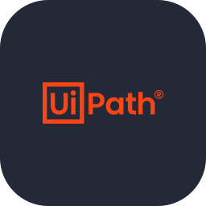
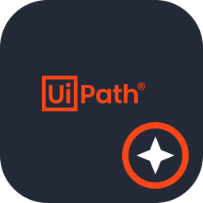
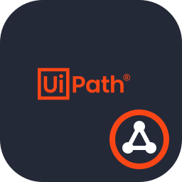
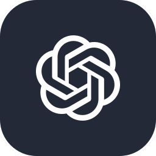
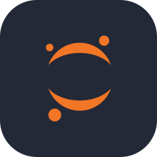
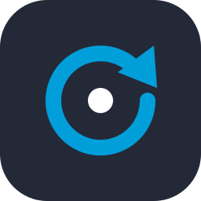
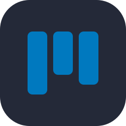

 

---

<h2 align="center">Hola, soy Yazmín</h2>

Soy una desarrolladora que disfruta estar en <b>todas las etapas de un proyecto</b>: organizar al equipo, planear las tareas, diseñar la experiencia del usuario y darle vida en la pantalla.

Lo que me distingue es que <b>combino la visión de gestión con la parte técnica</b>. He liderado equipos, he construido interfaces web y móviles, y he creado robots con inteligencia artificial que automatizan tareas completas. Esa mezcla me permite entender cómo encaja cada pieza y ayudar a que el proyecto avance de principio a fin.

Mis proyectos nacen de problemas reales: <b>salud, educación y el cuidado del agua</b> en mi comunidad.

---

<h2 align="center">Lo que me distingue</h2>

<table>
<tr>
<td width="33%" align="center" valign="top">

<h3>Líder de proyectos</h3>
Coordino equipos, reparto responsabilidades y mantengo a todos enfocados en el objetivo.
</td>
<td width="33%" align="center" valign="top">

<h3>Gestión de proyectos</h3>
Planeo y doy seguimiento con <b>Scrum</b>, <b>Kanban</b> y metodologías híbridas.
</td>
<td width="33%" align="center" valign="top">

<h3>Frontend</h3>
Creo interfaces web y móviles con <b>Angular</b>, <b>React</b> y <b>Tailwind CSS</b>.
</td>
</tr>
<tr>
<td width="33%" align="center" valign="top">

<h3>Diseño de interfaces</h3>
Diseño sketches, wireframes y prototipos en <b>Figma</b> antes de programar.
</td>
<td width="33%" align="center" valign="top">

<h3>Documentación</h3>
Documento cada proyecto de forma clara para que cualquiera pueda entenderlo y continuarlo.
</td>
<td width="33%" align="center" valign="top">

<h3>Automatización</h3>
Creo robots y agentes con <b>UiPath</b> y la <b>API de OpenAI</b> que leen, clasifican y responden correos solos.
</td>
</tr>
</table>

---

<h2 align="center">Proyectos destacados</h2>

<table>
<tr>
<td width="50%" align="center" valign="top">

<h3 align="center">MedAlert+</h3>

Un <b>pastillero automatizado</b> conectado a una plataforma con <b>asistente conversacional con IA</b>, para que pacientes y familias den seguimiento a sus tratamientos sin complicaciones.

<b>Mi rol:</b> frontend, base de datos y documentación.

<code>Angular</code> <code>IA</code> <code>IoT</code> <code>MongoDB</code>

</td>
<td width="50%" align="center" valign="top">

<h3 align="center">PillBox</h3>

Un <b>pastillero inteligente IoT</b> integrado a una botella, con app móvil y plataforma web para programar horarios, recibir alertas y monitorear la medicación en tiempo real.

<b>Mi rol:</b> frontend, base de datos y documentación.

<code>Angular</code> <code>React Native</code> <code>Arduino</code> <code>MongoDB</code>

</td>
</tr>
<tr>
<td width="50%" align="center" valign="top">

<h3 align="center">Órbita Kids</h3>

Una <b>aventura espacial</b> donde niños de 6 a 9 años practican sumas, exploran planetas y reparan su nave. Incluye app móvil para estudiantes y una PWA para docentes.

<code>Flutter</code> <code>React</code> <code>FastAPI</code> <code>Figma</code>

</td>
<td width="50%" align="center" valign="top">

<h3 align="center">AquaVida</h3>

Una plataforma web para <b>cuidar el agua en Xicotepec</b>: permite reportar fugas, ver un mapa de zonas vulnerables y aprender a usar el agua de forma responsable.

<b>Mi rol:</b> desarrolladora frontend.

<code>HTML</code> <code>CSS</code> <code>JavaScript</code> <code>MySQL</code>

</td>
</tr>
</table>

---

<h2 align="center">Mi stack tecnológico</h2>

<h3 align="center">Frontend y móvil</h3>
<table align="center">
<tr><td align="center" width="96"> <b>HTML5</b></td><td align="center" width="96"> <b>CSS3</b></td><td align="center" width="96"> <b>JavaScript</b></td><td align="center" width="96"> <b>TypeScript</b></td><td align="center" width="96"> <b>React</b></td><td align="center" width="96"> <b>Angular</b></td></tr>
<tr><td align="center" width="96"> <b>Tailwind CSS</b></td><td align="center" width="96"> <b>Vite</b></td><td align="center" width="96"> <b>Flutter</b></td><td align="center" width="96"> <b>Dart</b></td></tr>
</table>

<h3 align="center">Automatización e IA</h3>
<table align="center">
<tr><td align="center" width="96"> <b>UiPath Studio</b></td><td align="center" width="96"> <b>UiPath Agents</b></td><td align="center" width="96"> <b>Orchestrator</b></td><td align="center" width="96"> <b>OpenAI</b></td><td align="center" width="96"> <b>Jupyter</b></td></tr>
</table>

<h3 align="center">Datos e integración</h3>
<table align="center">
<tr><td align="center" width="96"> <b>Python</b></td><td align="center" width="96"> <b>Node.js</b></td><td align="center" width="96"> <b>FastAPI</b></td><td align="center" width="96"> <b>MySQL</b></td><td align="center" width="96"> <b>MongoDB</b></td></tr>
</table>

<h3 align="center">Diseño, herramientas e IoT</h3>
<table align="center">
<tr><td align="center" width="96"> <b>Figma</b></td><td align="center" width="96"> <b>Git</b></td><td align="center" width="96"> <b>GitHub</b></td><td align="center" width="96"> <b>VS Code</b></td><td align="center" width="96"> <b>Docker</b></td><td align="center" width="96"> <b>Arduino</b></td></tr>
</table>

<h3 align="center">Gestión de proyectos</h3>
<table align="center">
<tr><td align="center" width="96"> <b>Scrum</b></td><td align="center" width="96"> <b>Kanban</b></td></tr>
</table>

---

<h2 align="center">Mi actividad en GitHub</h2>

---

<h2 align="center">¿Trabajamos juntos?</h2>

¿Tienes una idea, un proyecto o un proceso que quieras automatizar? Me encantaría escucharte.

